  

   

  

    
    
    
    
  

---

### `01 //` Selected Work & Research

<table>
  <tr>
    <td width="50%" valign="top">
      <h4>NeuroVentura &nbsp;<code>THESIS 2026</code></h4>
      

        
        
        
      

      
Late-fusion multimodal ML framework combining a frozen <b>MONAI 3D DenseNet-121</b> (MRI), <b>XGBoost</b>, and a <b>residual MLP</b> to predict Alzheimer's disease risk and progression.

    </td>
    <td width="50%" valign="top">
      <h4>WordBuilder &nbsp;<code>FLUTTER APK</code></h4>
      

        
        
        
      

      
Turn-based multiplayer vocabulary board game with a <b>custom TCP networking layer</b> for local hotspot play, offline dictionary validation, and <b>Firebase</b> real-time sync.

    </td>
  </tr>
  <tr>
    <td width="50%" valign="top">
      <h4>StudyDen &nbsp;<code>MERN STACK</code></h4>
      

        
        
        
      

      
Study spot discovery & live event platform with <b>geofenced attendance tracking</b>, gamification (points/badges/leaderboards), <b>Barikoi</b> search, and Google Calendar sync.

    </td>
    <td width="50%" valign="top">
      <h4>Tech-Aesthetics &nbsp;<code>MERN STACK</code></h4>
      

        
        
        
      

      
Full-stack inventory and sales platform with <b>real-time stock tracking</b>, pre-order & shipment ETA management, and an <b>admin profit-margin analytics</b> dashboard.

    </td>
  </tr>
</table>

---

### `02 //` Core Stack

  

---

### `03 //` GitHub Telemetry

  
   
  
  

